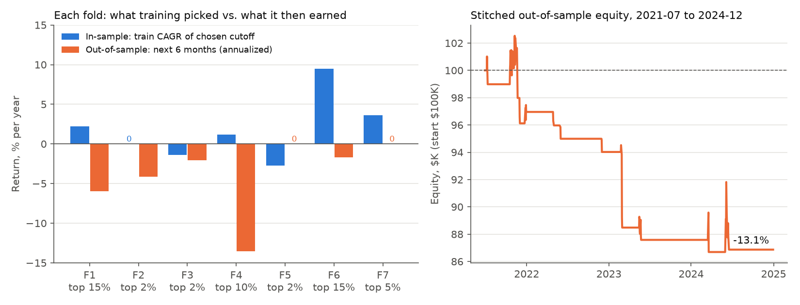

# Does a momentum-breakout edge survive out-of-sample?

A walk-forward test of a rules-based momentum strategy on US equities,
2020–2024. **Result: the in-sample edge did not survive validation. The
strategy was invalidated and no capital was ever risked.** The project is
paper-only and never placed a real order.



*Left: the cutoff picked in each 18-month training window (blue) against
what it earned over the next 6 unseen months (orange). Right: the 7 test
windows chained into one out-of-sample equity curve. Generated by
`scripts/plot_walkforward.py` from the files in `results/momentum/`.*

---

## Question

Mechanical momentum-breakout rules (buy the strongest stocks when they
break out of an orderly pullback, risk 1% per trade) produced **+10.5%
CAGR, Sharpe 0.90, 26 trades** on 2020–2024 once one parameter was set to
"top 10% by relative strength." That value was chosen *after* the
literal spec (top 2%) had failed on the same data.

**Does choosing that parameter on past data keep working on data the
choice never saw, or was 10.5% an artifact of in-sample selection?**

## Data

| | |
|---|---|
| Universe | All US-listed common stocks (NASDAQ, NYSE, NYSE American) from the NASDAQ Trader symbol directory: **5,309 symbols, 4,317 with usable price history** (ETFs, warrants, units, preferreds, and funds excluded) |
| Prices | Daily OHLCV, split/dividend-adjusted, from Yahoo Finance via `yfinance` |
| Period | 2020-01-01 → 2024-12-31; out-of-sample span 2021-07-01 → 2024-12-31 (42 months) |
| Liquidity gate (per day) | Price > $5, 50-day average dollar volume > $3.5M |

Source for the counts: `results/momentum/walkforward_run.log`.

## Method

**Strategy** (all rules in `strategy.py`, shared by backtest, scanner, and paper trader):

1. **Rank** every eligible stock daily by weighted 1/3/6-month return (40/35/25%) and keep the top *X*% cross-sectionally. *X* is the parameter under test.
2. **Setup filter**: ADR% > 5, above the 50- and 200-day SMA, a prior 30%+ move, rising 10/20 SMA, and an orderly 3–25-day pullback with tightening range and drying volume.
3. **Entry**: buy-stop above the 5-day high, taken only if the breakout bar's volume is ≥ 1.5× its 50-day average.
4. **Risk**: stop under the pullback low (clamped to 2–5%), position sized to risk 1% of equity, max 5 positions.
5. **Exit**: sell 25% at 5R and move the stop to breakeven; trail the rest on a close below the 20-day SMA.

**Why walk-forward instead of one backtest.** One backtest over
2020–2024 answers "what would the best parameter have earned if I had
known it in advance?" Here the parameter had been picked after seeing
2020–2024, so a full-period backtest could only confirm the choice it
was used to make. Walk-forward picks the parameter using past data
only, trades it on the next unseen window, and repeats. The stitched
test windows estimate what the *selection process* would have earned in
real time, which is the number that matters before risking money.

## Validation

**Folds.** 18-month train / 6-month test windows, stepped 6 months: 7 folds.
The test windows are contiguous and non-overlapping (2021-07 → 2024-12).

**Selection rule, fixed before any test window ran.** On each train
window, backtest every cutoff in {2%, 5%, 10%, 15%} and pick the highest
train CAGR (ties go to higher Sharpe, then more trades, then the earlier
cutoff). Only that cutoff runs on the test window, with a fresh $100K
and no positions carried over. Nothing was re-run or re-picked after
seeing test results, and every fold is reported, including zero-trade
folds.

**No lookahead.**
- Indicators and RS ranks are trailing. `find_setup` reads only bars up to and including day *t*.
- The watchlist is built at day *t*'s close and can only fill from day *t+1*.
- The optional SPY regime gate uses the prior session's close.
- **Known optimistic leaks:** the 1.5× volume check uses the breakout day's *full* volume while filling intraday, and a position isn't stop-checked on its entry day. Both make results look better, not worse, so they strengthen a negative conclusion.

**Transaction costs.** 0.1% slippage on entries and stop-outs (gap-downs
fill at the open), no slippage on profit-taking or trail exits, and no
commissions. Positions still open at a window's end are closed at the
last close.

## Results

All numbers come from `results/momentum/` (raw reports, fold CSVs, the
OOS equity curve, and the trade log). Fold-by-fold narrative:
[`WALKFORWARD_RESULTS.md`](WALKFORWARD_RESULTS.md).

**Per fold: the in-sample choice vs. what it earned next** (`walkforward_folds.csv`):

| Fold | Train window | Chosen cutoff | Train CAGR (in-sample) | Test window | Test return (OOS) | OOS trades |
|---|---|---|---|---|---|---|
| 1 | 2020-01 → 2021-06 | 15% | +2.2% | 2021-07 → 2021-12 | −3.0% | 4 |
| 2 | 2020-07 → 2021-12 | 2% | 0.0% | 2022-01 → 2022-06 | −2.0% | 2 |
| 3 | 2021-01 → 2022-06 | 2% | −1.4% | 2022-07 → 2022-12 | −1.0% | 1 |
| 4 | 2021-07 → 2022-12 | 10% | +1.2% | 2023-01 → 2023-06 | −6.8% | 3 |
| 5 | 2022-01 → 2023-06 | 2% | −2.7% | 2023-07 → 2023-12 | 0.0% | 0 |
| 6 | 2022-07 → 2023-12 | 15% | +9.5% | 2024-01 → 2024-06 | −0.8% | 3 |
| 7 | 2023-01 → 2024-06 | 5% | +3.6% | 2024-07 → 2024-12 | 0.0% | 0 |

**Headline: in-sample vs. out-of-sample.**

| | Span | Total return | CAGR | Sharpe | Max DD | Trades |
|---|---|---|---|---|---|---|
| In-sample: top 10% picked after the fact (pre-fix filters)¹ | 2020–2024 | +64.5% | +10.5% | 0.90 | −12.3% | 26 |
| Fixed top 10%, OOS span (still a hindsight pick) | 2021-07 → 2024-12 | +4.7% | +1.3% | 0.17 | −15.9% | 25 |
| **Walk-forward OOS (cutoff chosen on past data only)** | 2021-07 → 2024-12 | **−13.1%** | **−3.9%** | **−0.65** | **−15.5%** | **13** |

¹ `backtest_report_top10pct.txt`. Produced before two filter bugs were
fixed (ADR > 4 instead of the spec's > 5; a 1M-share volume floor instead
of $3.5M dollar volume). The other rows use the corrected filters
(`walkforward_report.txt`). The 13 OOS trades had a 15.4% win rate and
averaged −1.07R.

**How overfitting was exposed:**
1. **Unstable selection.** The "best" cutoff jumped 15 → 2 → 2 → 10 → 2 → 15 → 5 across folds. A real edge would keep pointing to the same region.
2. **Train performance didn't predict test performance.** Every fold with a positive train CAGR lost money or was flat out of sample. Fold 6's best training result (+9.5%) was followed by −0.8%.
3. **The 10.5% was partly a bug artifact.** With the source-accurate filters, even the hindsight top-10% pick fell to +1.3% CAGR on the OOS span. Under the original buggy filters the same walk-forward gave −0.8% CAGR against a +10.4% hindsight benchmark (`walkforward_report_adr4_sharevol.txt`), so the gap appeared under both filter versions.
4. **One pre-registered rescue also failed.** The hypothesis was that losses came from bad market regimes, so entries were gated on SPY > 200-day SMA. Result: −0.9% CAGR, with no positive fold among the seven and an average trade of −0.61R (`walkforward_report_spy200.txt`). The gate lost less only because it traded less; the hindsight top-10% benchmark fell to +0.2% CAGR.

## Decision

**Momentum invalidated. Never risked capital.** The selection process
earned −3.9% CAGR out of sample. The strategy was parked and not tuned
further: testing more variants on the same 2020–2024 data would turn it
into a multiple-comparisons search. Any revival has to be a new
hypothesis, written down before it runs.

The same protocol was later applied to three more strategies across five
instruments (mean reversion on SPY/QQQ, breakout on BTC/USD, trend on
GLD/USO). **All five failed out of sample**
(`results/suite/wf_suite_report.txt`). A zero-cost re-run of SPY, QQQ,
and BTC still lost money, which rules out costs as the cause (suite
section of `WALKFORWARD_RESULTS.md`). None are enabled.

## Limitations

- **Survivorship bias.** The universe is today's listings, so stocks delisted in 2020–2024 are missing. This inflates returns; the reports estimate a 1–4 point CAGR haircut. A point-in-time universe needs a paid data feed.
- **Small samples.** Train windows held 0–28 trades and test windows 0–4. Ranking cutoffs by train CAGR at these counts is partly ranking noise. The walk-forward rejects this selection process; it doesn't prove that no fixed cutoff could ever work.
- **One market period.** 2020–2024 covers a crash, a bull run, a bear market, and a recovery, but it is still one sequence of regimes.
- **Fill model.** Daily bars only, fixed slippage, no commissions, and the two optimistic leaks noted under Validation.
- **Adjusted Yahoo data** may differ from what was tradable at the time.

## How to run

Requires Python 3.11.

```bash
git clone https://github.com/Rudra-C-Patel/trading-bot.git && cd trading-bot
python3.11 -m venv .venv && source .venv/bin/activate
pip install -r requirements.txt

python -m pytest -q tests              # 35 unit tests
python scripts/plot_walkforward.py     # rebuild the figure from results/

# Re-run the experiments (the first run downloads ~5,300 tickers from
# Yahoo, roughly 20-40 min, then caches them in data/; outputs go to data/)
python backtest.py --top-pct 0.10      # in-sample full-period backtest
python walkforward.py                  # the walk-forward above
python walkforward.py --spy-filter     # SPY > 200-SMA regime-gate variant
```

`results/` is a frozen copy of the outputs these numbers come from.
`data/` (git-ignored) holds caches and fresh run outputs. Yahoo
re-adjusts history and listings change, so a fresh download may not
reproduce `results/` to the decimal.

### Also in this repo

Supporting infrastructure, all paper-only:

| Path | What it is |
|---|---|
| `strategy.py`, `backtest.py`, `walkforward.py`, `scanner.py`, `paper_trader.py` | Momentum strategy, backtester, walk-forward harness, daily scanner, paper-trading engine |
| `bot/` | Multi-instrument suite (data layer, execution engine, 3 strategies, walk-forward). `ENABLED = []` |
| `wheel_bot.py`, `wheel_backtest.py`, `config.py` | Options-wheel bot and its Black-Scholes-approximation backtest. Never walk-forward tested |
| `alpaca_broker.py` | Alpaca paper adapter. Hard-refuses any non-paper host or account |
| `risk_manager.py` | Shared risk layer: 5% combined open-risk ceiling, one strategy per ticker |
| `CURRENT_STATUS.md` | Current status of every strategy |

Broker credentials (only needed for the paper bots, not the research)
live in a git-ignored `.env`: `ALPACA_API_KEY`, `ALPACA_SECRET_KEY`,
`ALPACA_BASE_URL`.

*Not financial advice. Paper trading only.*
